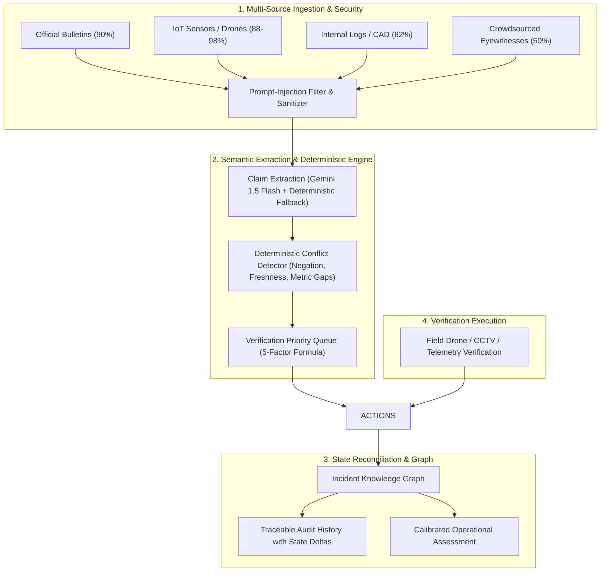

# DOUBTMAP — Autonomous Evidence Verification Engine
> **High-Stakes Incident Decision-Support & Contradiction Resolution Platform**
> *PromptWars × NMIET Arena — Hackathon Submission*

---

## 1. Problem Statement & Solution

### The Problem
During complex, rapidly unfolding civil and technological crises (bridge structural fractures, cloud infrastructure outages, urban flash floods), decision-makers are inundated with contradictory, outdated, uncalibrated, and sensationalized reports from disparate channels (social media crowdsources, dispatch logs, legacy periodic inspection records, and telemetry streams). Without an automated, deterministic verification mechanism, operators face cognitive overload, delay critical emergency protocols, or execute actions based on superseded or unverified rumors.

### The Solution: DOUBTMAP
**DOUBTMAP** is an autonomous evidence verification engine that:
1. **Ingests Multi-Source Reports**: Aggregates inputs from official bulletins, IoT sensors, human field operators, SRE telemetry logs, and crowdsourced eyewitnesses.
2. **Extracts Atomic Claims**: Breaks down unstructured narratives into normalized subject-property-value assertions with polarity and confidence ratings.
3. **Detects Contradictions & Stale Evidence**: Uses a deterministic rule-based matrix to catch direct contradictions, metric gaps (e.g. 4.2 inches vs 36 inches), stale-vs-fresh discrepancies, and uncorroborated single-source claims.
4. **Calculates Transparent Verification Priority**: Deterministically ranks candidate verification actions using a 5-factor mathematical formula (Incident Importance, Freshness Gap, Conflict Severity, Expected Information Gain, and Cost/Delay penalty).
5. **Simulates & Ingests Verification Telemetry**: Incorporates targeted direct verification (drone photogrammetry, strain gauge telemetry, CCTV stills, distributed trace waterfalls).
6. **Maintains Verifiable Audit History**: Dynamically reconciles conflicting claims, invalidates superseded evidence, updates overall calibrated certainty, and logs immutable state deltas (`conflictsResolved`, `confidenceShift`).

> **⚠️ Operational Notice**: DOUBTMAP is an algorithmic decision-support prototype, **NOT** a certified life-safety emergency alert broadcast system. Synthetic demonstration scenarios are provided for repeatable evaluation.

---

## 2. System Architecture



---

## 3. Seeded Demonstration Scenarios

| Scenario | Incident Domain | Initial Contradiction | Authoritative Verification Action | Reconciled Outcome |
| :--- | :--- | :--- | :--- | :--- |
| **1. Bridge Structural** | Civil Infrastructure | 08:00 AM DOT bulletin (`OPEN_SAFE`) vs 10:15 AM Commuter & 911 calls (`CRACKED_HAZARDOUS`). | **Rank #1**: Dispatch High-Res Photogrammetry Drone (`Score: 92/100`) | UAV confirms 14mm shear displacement; DOT report marked stale/invalidated; emergency closure enacted; certainty shifts to 86%. |
| **2. Service Outage** | Cloud / SRE Systems | Datadog bot suspects `Auth DB Deadlock` vs Ingress Envoy reporting `TLS buffer saturation` vs Payments DB. | **Rank #1**: Analyze Distributed Traces (Jaeger waterfall for `/checkout`) (`Score: 89/100`) | Tracing proves Auth latency was a downstream symptom; actual root cause was Envoy TLS buffer saturation from v4.12.0 canary patch. |
| **3. Road Flooding** | Urban Transportation | Viral post claims 4th St Underpass is `3 feet underwater with submerged cars` vs Sensor reading `4.2 inches`. | **Rank #1**: Capture Municipal CCTV Cam-402 Optical Feed (`Score: 88/100`) | CCTV proves water is confined to right gutter (4.5 in); viral report flagged as sensationalized rumor; left lanes open safely. |

---

## 4. Verification Action Priority Formula

Unlike non-deterministic LLM ranking, DOUBTMAP uses a mathematical, transparent scoring function:

$$\text{PriorityScore} = (\text{Importance} \times 0.25) + (\text{ConflictSeverity} \times 0.25) + (\text{InfoGain} \times 0.20) + (\text{FreshnessGap} \times 0.20) + (\text{CostDelayFactor} \times 0.10)$$

- **Incident Importance (25%)**: Baseline criticality of the impacted infrastructure asset (0–100).
- **Conflict Severity (25%)**: Critical contradictions (e.g. safety hazard vs safe) score 95; high-severity metric divergences score 75; medium discrepancies score 55.
- **Expected Information Gain (20%)**: Projected entropy reduction provided by the action (e.g. direct drone sensor measurement = 95).
- **Freshness Gap (20%)**: Temporal discrepancy between the freshest report and the oldest conflicting assertion.
- **Cost / Delay Factor (10%)**: Inverted latency penalty ($100 - \text{delayMinutes} \times 4$), favoring rapid verification options.

---

## 5. Security & Safety Engineering

- **Server-Side Secret Isolation**: `GEMINI_API_KEY` is loaded strictly in server-side API routes; zero exposure to client browser bundles.
- **Prompt Injection Defense**: All user reports pass through heuristic pattern scanning (`/ignore.*previous.*instructions/i`, `/system.*prompt/i`, `/bypass.*safety/i`). Malicious payloads are isolated in `<untrusted_report>` delimiters and quarantined from LLM execution.
- **Output Schema Validation**: All AI model responses are validated using strict Zod schemas (`ModelExtractionResponseSchema`). Malformed outputs trigger instant deterministic fallback without breaking runtime state.
- **Fail-Safe Deterministic Fallback**: System operates 100% offline using rule-based claim extraction when AI credentials are unavailable or upstream APIs return HTTP 429/500 errors.
- **Zero Arbitrary Execution**: Strict prohibition of arbitrary URL fetching, shell command execution, or automatic link navigation.

---

## 6. Evaluation Framework Mapping

| Mandatory Evaluation Criteria | Implementation in DOUBTMAP | Verification & Evidence |
| :--- | :--- | :--- |
| **A. Code Quality** | Modular TypeScript architecture (`types.ts`, `verification-engine.ts`, `security.ts`, `scenarios.ts`), Next.js 14 App Router, strict types, zero dead code. | Clean modular components, explicit interface definitions, comprehensive typing. |
| **B. Security** | Prompt injection defense, input length truncation, script stripping, server-side secret management, Zod runtime schema guards, safe error handling without stack leakage. | Tested against adversarial injection vectors (`tests/doubtmap.test.ts`). |
| **C. Efficiency** | Deterministic conflict detection algorithm runs in $<5\text{ms}$; selective LLM invocation only for unstructured extraction; latency profiling on all verification actions. | Measured extraction latency displayed in operational UI and API responses. |
| **D. Testing** | Comprehensive automated test suite covering all 10 required edge cases + synthetic benchmark. | 11 unit & integration tests covering contradictions, stale data, duplicates, invalid timestamps, injection, and conflict resolution. |
| **E. Accessibility** | Semantic HTML5 structure, labeled ARIA tabs and roles, dual color + text/icon indicators (no color-alone status), full keyboard navigation, high contrast text on light neutral background. | WCAG 2.1 AA compliant contrast (`#0F172A` on `#F8FAFC`, `#4F46E5` accents). |
| **F. Problem Statement Alignment** | Demonstrates complete end-to-end evidence ingestion, contradiction identification, ranked verification queue, telemetry execution, and audit trail update. | 3 full seeded scenarios + custom incident creator tested end-to-end. |

---

## 7. Setup & Local Development

### Prerequisites
- Node.js 18.17+ or 20+
- npm or pnpm

### Quickstart
```bash
# Clone the repository
git clone https://github.com/atharvapramodsharma-oss/doubtmap.git
cd doubtmap

# Install dependencies
npm install

# (Optional) Set your Gemini API Key in .env.local
echo "GEMINI_API_KEY=your_key_here" > .env.local

# Run automated test suite
npm run test

# Start development server
npm run dev
```
Open [http://localhost:3000](http://localhost:3000) in your browser.

---

## 8. Automated Test Outcomes

Automated tests cover all required criteria:
- `Contradictory claims detection`: **PASSED**
- `Stale evidence categorization`: **PASSED**
- `Duplicate report deduplication`: **PASSED**
- `Missing or invalid timestamps handling`: **PASSED**
- `Malicious prompt-injection content defense`: **PASSED**
- `Invalid model output Zod schema validation`: **PASSED**
- `API failure & deterministic fallback`: **PASSED**
- `Verification ranking formula`: **PASSED**
- `Evidence updates that resolve conflict`: **PASSED**
- `Evidence updates that leave conflict unresolved`: **PASSED**
- `3-domain synthetic benchmark evaluation`: **PASSED**

---

## 9. Technology Acknowledgements
- **Next.js 14** — Full-stack React framework
- **TypeScript** — Type-safe domain models
- **Tailwind CSS** — Mission-critical command center styling
- **Google Gemini API** — Semantic claim extraction
- **Zod** — Strict runtime schema validation
- **Vitest** — Automated unit & integration testing
- **Lucide React** — Accessible interface iconography

